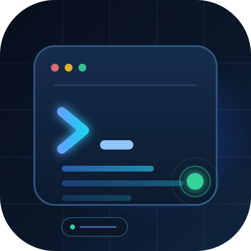
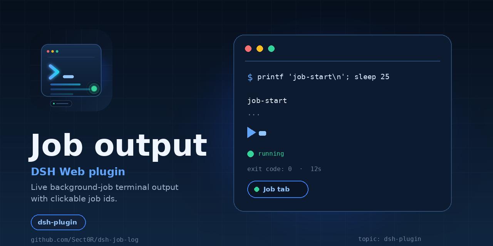

<p align="center">
  
</p>

<h1 align="center">Job output</h1>

<p align="center">
  <strong>A DSH Web plugin that adds a live background-job terminal tab and makes job ids clickable.</strong>
</p>

<p align="center">
  
  
  
</p>

<p align="center">
  
</p>

## Why

`job_output` is a model-facing read: it advances the model's own cursor and is
not a terminal. Watching a long-running background job from the Web UI should
not require asking the model to read it again. This plugin gives the human a
live view and keeps the model's cursor untouched.

## Features

- **Job tab** (`conversation.view` id `job-log`, order 20) beside Trajectory
  and Statistics; labels are `Job` / `Задание`.
- **Live output** through the client-only `ctx.jobs` service:
  `watchRows(sessionId)`, `observe(sessionId, jobId)`, `kill(sessionId, jobId)`.
- **Clickable job ids** in the `job_output`, `job_list`, and `job_kill` tool
  cards. A click selects that job in the Job tab.
- **Job list with search** across running and finished jobs; running jobs are
  listed first.
- Status, duration, command, exit code / detail, and a monospace output block.
- Autoscroll with a pause when the reader scrolls up, plus **Jump to latest**.
- Copy the command and the output.
- Two-step stop for a running job: arm, then confirm within three seconds.
- Empty, loading, unknown-id, retention-gap, stream-error, and host-restart
  states without crashing.
- `ru` / `en` dictionaries and native keyboard-focusable controls.

## Install

The repository is a DSH bundle: `package.json` declares `dsh.bundle.patch` and
`dsh.client`, and the patch inserts one loader row.

```text
plugin_manager action=install_bundle target=/absolute/path/to/this/repository
```

For a local profile, that adds `@local/job-log` and the `job-log` row. Restart
or refresh the Web page if the tab does not appear immediately.

The host half is a no-op; the browser module is `client.js`.

## Use

1. Start a long-running background job from a session.
2. Open the **Job** tab. The list shows the session's jobs.
3. Click a `job_id` in a `job_output` / `job_list` / `job_kill` card to open the
   tab with that job selected.
4. Use the search field to filter the list if the tab was opened manually.
5. Watch the output stream; scroll up to pause autoscroll, then use
   **Jump to latest**.
6. Stop a running job with **Stop**, then **Confirm stop**.

If the tab is folded into the header's **More** menu, the card's job id can
still select the job after you open the tab manually; the selection is kept in
the plugin and in the conversation store's view request.

## How it works

- `client.js` registers the `conversation.view` entry and the three
  `tool.call.toolview` overrides at priority `-10` (the slot election renders
  the lowest priority, so the plugin's cards replace the shipped job cards).
- The view consumes `viewRequest`, selects `viewRequest.focus`, and calls
  `completeViewRequest()` after applying it.
- A card click tries three navigation paths, best first:
  1. the live per-session Conversation store's `openView` action (the same
     action the shell uses);
  2. the shell's `openView` callback captured when the Job view last rendered;
  3. a tab-button click (and the More menu path) after recording the pending
     job, which the view reads on mount.
- The first path reads the registry's cached `conversation.session` store
  instance. That is a best-effort internal lookup, guarded and backed by the
  fallback paths.
- Trajectory, Statistics, Chat, and the other tool cards are not modified.

## Compatibility

- DSH Web `0.2.2-rc.1` (the version this plugin was built and verified against).
- Client services used: `jobs`, `slots`, `locale`, `uiConversation`.
- No model-facing tool, prompt, session event, or cursor is added or changed.

## Limitations

- The Job tab is browser UI only; terminal ANSI control sequences are stripped
  for readability, so colors are not reproduced.
- The tool cards intentionally show a compact recorded result; the full live
  stream stays in the Job tab.
- The store lookup in step 1 of the navigation is implementation-specific. If
  a future DSH build changes that registry, the tab-button fallback still
  navigates; a card may then show a hint to open the tab manually.
- A host restart can drop the job ring; the tab then shows an empty or
  not-found state with a restart hint.

## Development

No build step is required: `client.js` is the browser module, and `index.js` is
the no-op host half.

```text
node --check client.js
node --check index.js
```

Then install the directory as a local bundle and exercise the tab/card paths in
the running Web GUI. The plugin manager row is `job-log`.

Repository files:

| File | Role |
|---|---|
| `client.js` | Browser module: dictionaries, styles, view, tool cards, navigation |
| `index.js` | Host half: no-op loader row |
| `cordis.patch.yml` | Bundle patch inserting the `job-log` row |
| `icon.svg` | Plugin Manager icon |
| `assets/` | Logo, icons, and the social preview |
| `locale/` | Plugin Manager title/description (en, ru) |

## Discoverability

This repository is meant to be found through the GitHub topic
[`dsh-plugin`](https://github.com/topics/dsh-plugin). Topics and the social
preview are public-repository surfaces:

- Add topics in the repository's **About** section (the gear icon) —
  `dsh-plugin`, `deepseek-harness`, `dsh`. Topics on a private repository are
  not publicly discoverable.
- Set the social preview under **Settings → General → Social preview** using
  [`assets/social-preview.png`](assets/social-preview.png) (1280 × 640, under
  1 MB). GitHub exposes this setting for public repositories, or for private
  repositories that already have an uploaded image; a new private repository
  does not show it.
- GitHub repositories do not have a separate avatar — the repository page shows
  the owner's avatar. [`assets/icon-128.png`](assets/icon-128.png) is the DSH
  Plugin Manager icon, not a GitHub repository avatar.

Suggested repository description:

> DSH Web plugin: live background-job terminal output with clickable job ids.

## License

MIT. See [LICENSE](LICENSE).
